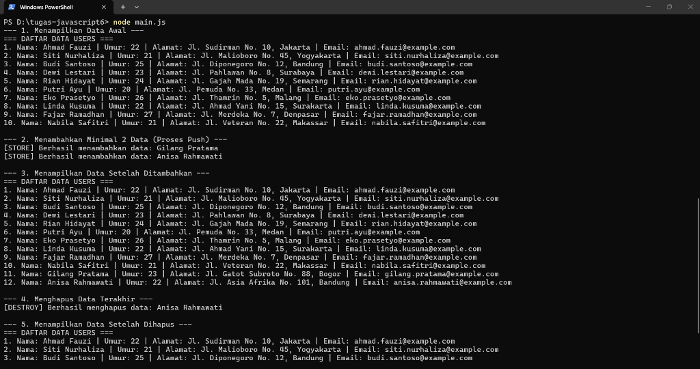
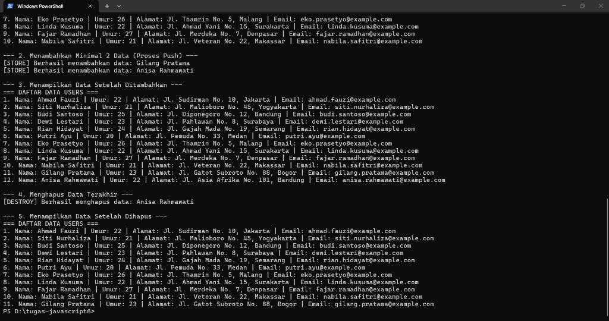

# Tugas Pertemuan 6 JavaScript

Program JavaScript sederhana berbasis modular ES Modules (ESM) menggunakan ekstensi `.js` untuk mengelola data user tanpa menggunakan HTML (berjalan langsung di terminal / console Node.js).

---

## Identitas Mahasiswa

- Nama: Alzafran Nobel Dwi Ari Putra
- Afiliasi: STT NF

---

## Deskripsi Tugas dan Spesifikasi

1. **`data.js`**: Berisi array of object dengan 10 data pengguna (properti: `nama`, `umur`, `alamat`, `email`).
2. **`controller.js`**: Berisi 3 fungsi utama pengelola data:
   - `index()`: Menampilkan seluruh data pengguna menggunakan metode `map()`.
   - `store(user)`: Menambahkan data pengguna baru ke array menggunakan `push()`.
   - `destroy()`: Menghapus data pengguna terakhir dari array menggunakan `pop()`.
3. **`main.js`**: File utama untuk menjalankan alur program:
   - Menampilkan data awal.
   - Menambahkan minimal 2 data baru melalui fungsi `store()`.
   - Menampilkan data yang telah bertambah.
   - Menghapus data terakhir melalui fungsi `destroy()`.
   - Menampilkan data akhir setelah proses penghapusan.

---

## Struktur File

```text
tugas-javascript6/
├── screenshots/
│   ├── screenshot-hasil-1.png
│   └── screenshot-hasil-2.png
├── data.js           # Data array of object (10 data pengguna awal)
├── controller.js     # Controller berisi fungsi index, store, destroy
├── main.js           # Entry point utama eksekusi program
├── package.json      # Konfigurasi project ("type": "module")
└── README.md         # Panduan cara menjalankan program
```

---

## Prasyarat

Pastikan komputer Anda sudah terinstal **Node.js** (versi 14 atau yang lebih baru).
Untuk memeriksa instalasi Node.js, buka terminal/PowerShell dan jalankan:
```bash
node -v
```

---

## Cara Menjalankan Program

1. Buka folder proyek ini di terminal atau **VS Code**:
   ```bash
   cd d:\tugas-javascript6
   ```

2. Jalankan perintah berikut di terminal:
   ```bash
   node main.js
   ```
   *atau menggunakan npm script:*
   ```bash
   npm start
   ```

---

## Contoh Output Terminal

Saat dijalankan, output di terminal akan menampilkan:

```text
--- 1. Menampilkan Data Awal ---
=== DAFTAR DATA USERS ===
1. Nama: Ahmad Fauzi | Umur: 22 | Alamat: Jl. Sudirman No. 10, Jakarta | Email: ahmad.fauzi@example.com
2. Nama: Siti Nurhaliza | Umur: 21 | Alamat: Jl. Malioboro No. 45, Yogyakarta | Email: siti.nurhaliza@example.com
3. Nama: Budi Santoso | Umur: 25 | Alamat: Jl. Diponegoro No. 12, Bandung | Email: budi.santoso@example.com
4. Nama: Dewi Lestari | Umur: 23 | Alamat: Jl. Pahlawan No. 8, Surabaya | Email: dewi.lestari@example.com
5. Nama: Rian Hidayat | Umur: 24 | Alamat: Jl. Gajah Mada No. 19, Semarang | Email: rian.hidayat@example.com
6. Nama: Putri Ayu | Umur: 20 | Alamat: Jl. Pemuda No. 33, Medan | Email: putri.ayu@example.com
7. Nama: Eko Prasetyo | Umur: 26 | Alamat: Jl. Thamrin No. 5, Malang | Email: eko.prasetyo@example.com
8. Nama: Linda Kusuma | Umur: 22 | Alamat: Jl. Ahmad Yani No. 15, Surakarta | Email: linda.kusuma@example.com
9. Nama: Fajar Ramadhan | Umur: 27 | Alamat: Jl. Merdeka No. 7, Denpasar | Email: fajar.ramadhan@example.com
10. Nama: Nabila Safitri | Umur: 21 | Alamat: Jl. Veteran No. 22, Makassar | Email: nabila.safitri@example.com

--- 2. Menambahkan Minimal 2 Data (Proses Push) ---
[STORE] Berhasil menambahkan data: Gilang Pratama
[STORE] Berhasil menambahkan data: Anisa Rahmawati

--- 3. Menampilkan Data Setelah Ditambahkan ---
=== DAFTAR DATA USERS ===
1. Nama: Ahmad Fauzi | Umur: 22 | Alamat: Jl. Sudirman No. 10, Jakarta | Email: ahmad.fauzi@example.com
...
10. Nama: Nabila Safitri | Umur: 21 | Alamat: Jl. Veteran No. 22, Makassar | Email: nabila.safitri@example.com
11. Nama: Gilang Pratama | Umur: 23 | Alamat: Jl. Gatot Subroto No. 88, Bogor | Email: gilang.pratama@example.com
12. Nama: Anisa Rahmawati | Umur: 22 | Alamat: Jl. Asia Afrika No. 101, Bandung | Email: anisa.rahmawati@example.com

--- 4. Menghapus Data Terakhir ---
[DESTROY] Berhasil menghapus data: Anisa Rahmawati

--- 5. Menampilkan Data Setelah Dihapus ---
=== DAFTAR DATA USERS ===
1. Nama: Ahmad Fauzi | Umur: 22 | Alamat: Jl. Sudirman No. 10, Jakarta | Email: ahmad.fauzi@example.com
...
11. Nama: Gilang Pratama | Umur: 23 | Alamat: Jl. Gatot Subroto No. 88, Bogor | Email: gilang.pratama@example.com
```

---

## Langkah Push ke GitHub dan Pengumpulan LMS

Jika Anda ingin mengunggah project ini ke repository GitHub:

1. Buka terminal di folder tugas ini.
2. Inisialisasi Git dan Commit file:
   ```bash
   git init
   git add .
   git commit -m "feat: selesaikan tugas pertemuan 6 js"
   ```
3. Hubungkan ke repository GitHub Anda (ganti URL sesuai repo private Anda):
   ```bash
   git branch -M main
   git remote add origin <URL_REPOSITORY_GITHUB_ANDA>
   git push -u origin main
   ```
4. Salin link repository GitHub Anda dan kirimkan ke LMS.

---

## Screenshot Hasil

Berikut adalah bukti tangkapan layar eksekusi program di terminal PowerShell:




